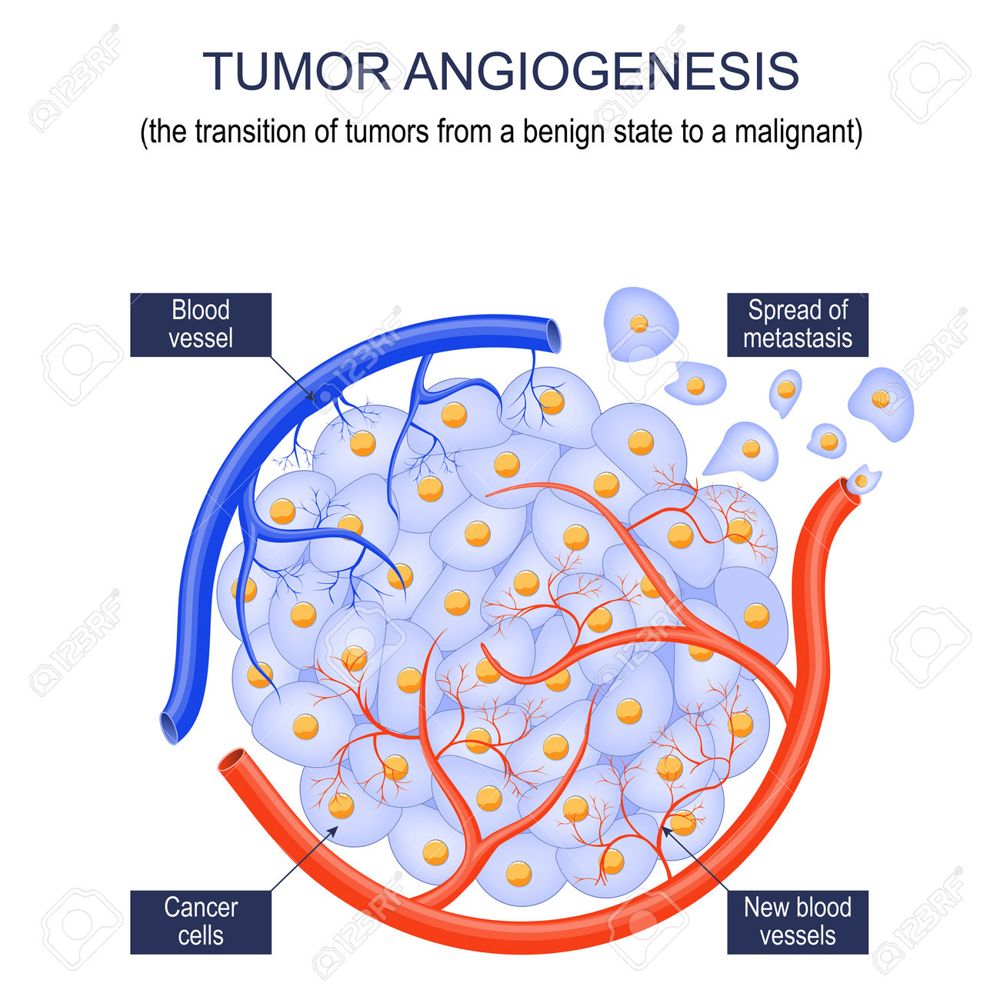
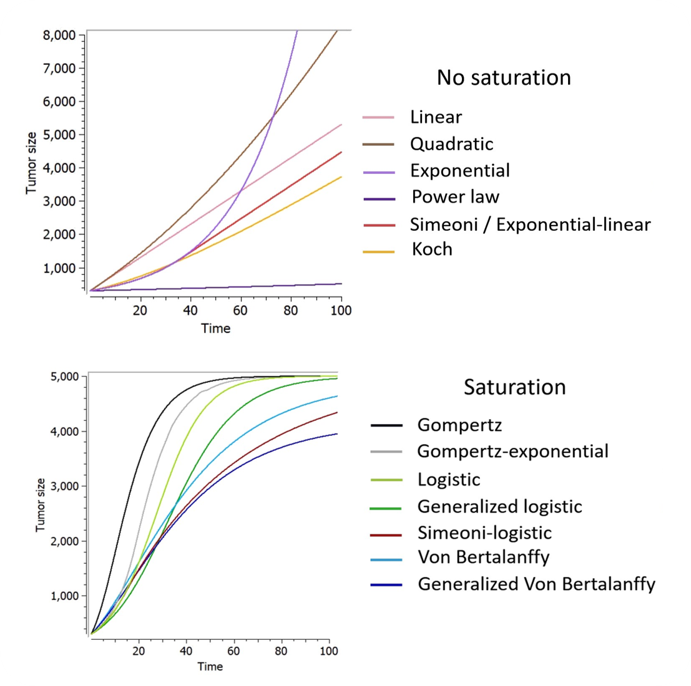
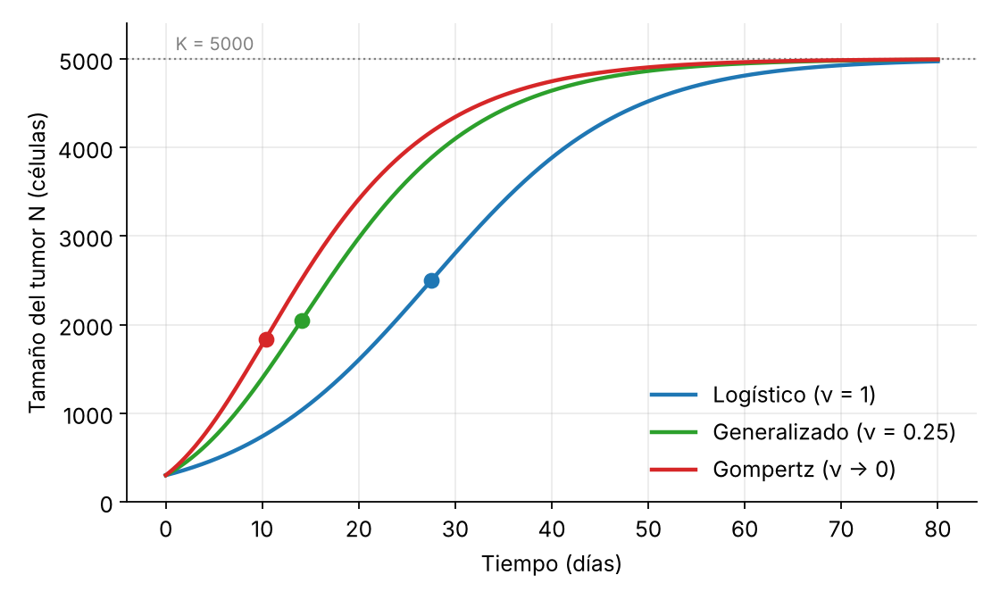
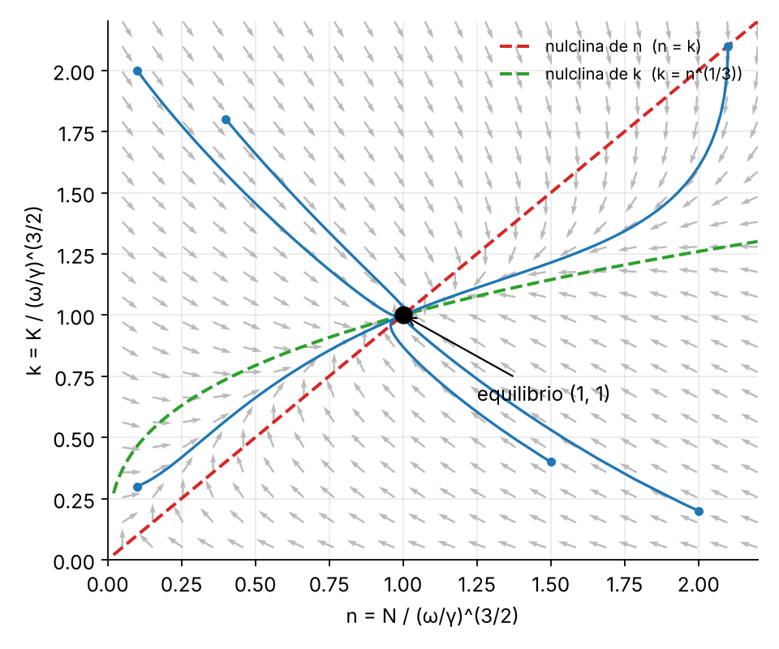
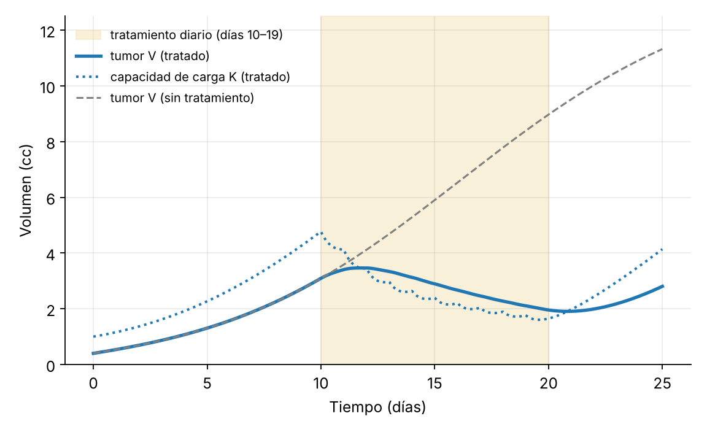
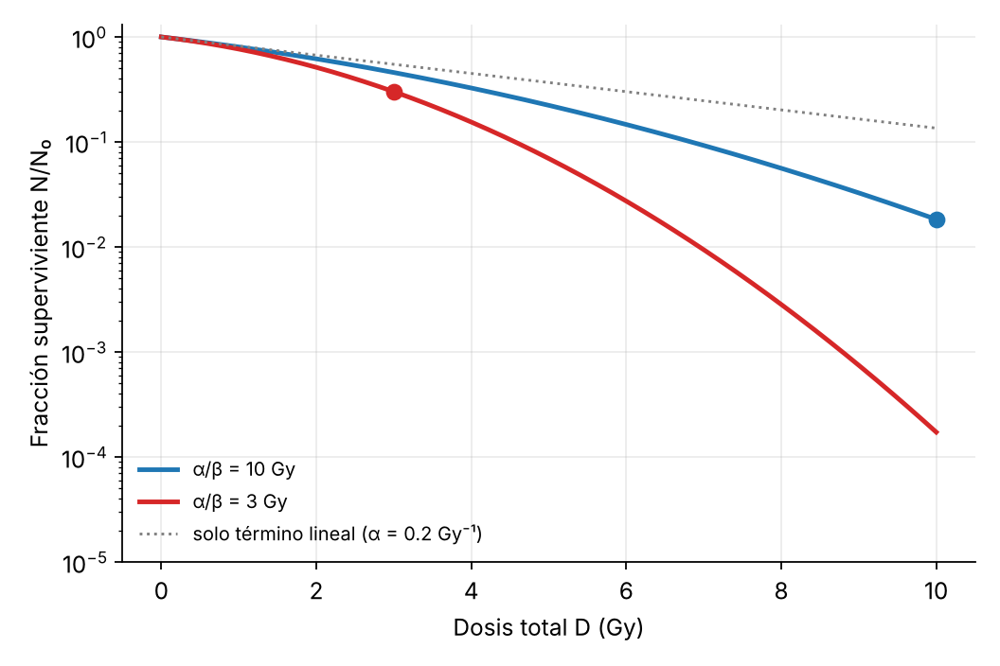
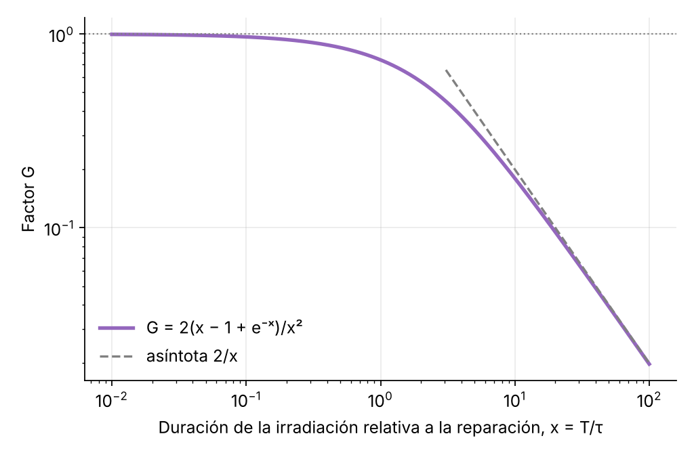
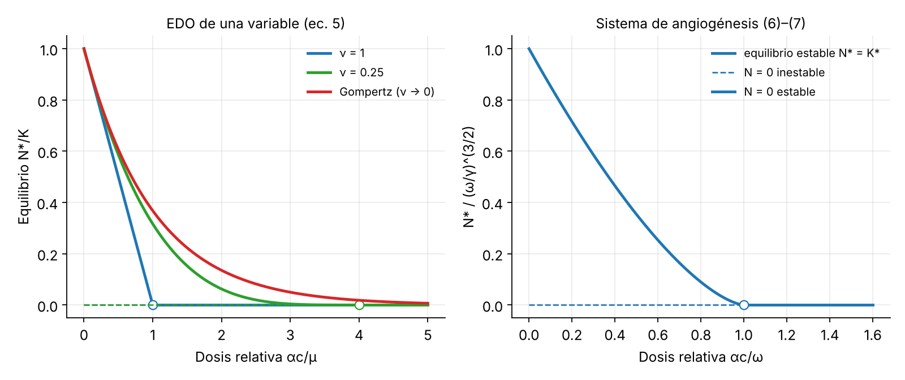

<h1 align="center">Modelos de EDO para el crecimiento tumoral y su tratamiento</h1>

<p align="center">
  
  
  
  
</p>

<p align="center">
  
</p>

<p align="center"><em>Figura 1. Angiogénesis tumoral: el tumor recluta vasos nuevos (rojo) que le llevan oxígeno y nutrientes, aumentan su capacidad de carga y abren la vía a la diseminación.</em></p>

## Descripción del proyecto

Este proyecto estudia, con ecuaciones diferenciales ordinarias, cómo crece un tumor sólido y cómo responde a dos tratamientos: los fármacos antiangiogénicos y la radioterapia. Se basa en el artículo de Sachs, Hlatky y Hahnfeldt (2001), *Simple ODE Models of Tumor Growth and Anti-Angiogenic or Radiation Treatment*.

La Figura 1 resume la idea central. Un tumor pequeño puede quedarse latente, pero para crecer necesita vasos sanguíneos nuevos que le lleven oxígeno y nutrientes. Esos vasos aumentan su capacidad de carga, es decir, el número máximo de células que el entorno puede sostener. Si se frena la formación de vasos, se frena también el tumor.

El trabajo avanza en cinco secciones, de la más simple a la más detallada:

1. **Sección 1 - Modelos de una EDO:** Logístico generalizado y Gompertz.
2. **Sección 2 - Angiogénesis:** Sistema (N, K) tumor-vasos sin tratamiento.
3. **Sección 3 - Tratamiento antiangiogénico:** Sistema (N, K) con c(t) variable.
4. **Sección 4 - Modelo LQ:** Radioterapia y modelo lineal-cuadrático.
5. **Sección 5 - Bifurcaciones:** Tratamiento constante y análisis de bifurcaciones.

Todo el desarrollo es determinista y vale para tumores ya grandes, de 1 mm³ o más, donde las fluctuaciones por número pequeño de células se pueden despreciar. El mensaje del artículo es que pocos parámetros bastan para capturar lo esencial; lo difícil es estimarlos.

## Objetivos y alcance

El objetivo es entregar un reporte de máximo 10 páginas y una exposición presencial de 15 minutos que cubran los cinco puntos que pide la orientación del curso:

1. **Derivación del modelo:** hipótesis biológicas y deducción de los modelos de una EDO, de angiogénesis (ecs. 6–7) y LQ (ecs. 8–9).
2. **Solución analítica:** separación de variables, equilibrio del sistema (N, K) e integración del modelo LQ hasta ln(N/N₀) = −αD − βGD².
3. **Análisis cualitativo:** equilibrios, estabilidad, atractor global y bifurcaciones, incluido el caso no autónomo con tratamiento.
4. **Simulación numérica:** método de Euler contra soluciones exactas, reproducción de la Fig. 1 del artículo y comparación del modelo LQ con su fórmula.
5. **Interpretación biológica:** la angiogénesis como explicación mecanicista de la desaceleración y el modelo LQ como herramienta de planificación en radioterapia.

Se omite la Sección 5 del artículo (generalizaciones con McKendrick–von Foerster, PDEs y modelos estocásticos). Como extensiones propias, el equipo añade el tratamiento constante con sus umbrales de erradicación, la adimensionalización del sistema (N, K) y un simulador interactivo.

## Estructura del repositorio

```
.
├── docs/                           # Documentación del curso y referencias
│   ├── Orientación Proyecto EDO.pdf
│   ├── Plan de trabajo – Proyecto Final de EDO (Tema 5).pdf
│   └── referencias/
│       └── 5. Models of Anti-Angiogenic Treatment.pdf
├── sections/                       # Código y resultados por sección
│   ├── seccion1_modelos_1edo/      # Modelos logístico generalizado y Gompertz
│   │   ├── scripts/
│   │   │   ├── modelos_edo.py          # Simulación y figuras (Fig. 2, 3)
│   │   │   └── manim_modelos_edo.py    # Presentación Manim
│   │   ├── docs/
│   │   │   └── Seccion_Sergio_Modelos_1EDO.pdf
│   │   └── outputs/
│   │       ├── fig2_comparacion_modelos.png
│   │       └── fig3_modelos_exactos.png
│   ├── seccion2_angiogenesis/      # Sistema tumor-vasos (N, K) sin tratamiento
│   │   ├── scripts/
│   │   │   ├── angiogenesis_fase_Alejandro.py  # Plano de fase, series, Euler vs RK45
│   │   │   └── animacion_manim_Alejandro.py    # Animación Manim convergencia
│   │   ├── docs/
│   │   │   ├── Seccion_Alejandro.md
│   │   │   └── angiogenesis_notas.pdf
│   │   └── outputs/
│   │       ├── fig1_angiogenesis.jpg
│   │       └── fig4_plano_fase.png
│   ├── seccion3_tratamiento_antiangiogenico/  # Tratamiento con c(t) variable
│   │   ├── scripts/                # (usa scripts de seccion2)
│   │   ├── docs/
│   │   │   └── Adan_Tratamiento_antiangiogenico_con_C(t)_variable.pdf
│   │   └── outputs/
│   │       └── fig5_tratamiento.png
│   ├── seccion4_modelo_LQ/         # Modelo lineal-cuadrático (radioterapia)
│   │   ├── scripts/
│   │   │   ├── lq.py                 # Función G, integración (8)-(9)
│   │   │   ├── params.py             # Parámetros y estilo de figuras
│   │   │   ├── figures.py            # Genera todas las figuras (Fig. 6, 7 + extras)
│   │   │   └── check_scipy.py        # Validación con SciPy (DOP853)
│   │   ├── docs/
│   │   │   ├── Session_Karel.md
│   │   │   └── EDO ARCH MIGUEL VIEWER.md
│   │   └── outputs/
│   │       ├── fig6_supervivencia_LQ.png
│   │       └── fig7_funcion_G.png
│   └── seccion5_bifurcaciones/     # Tratamiento constante y bifurcaciones
│       ├── scripts/
│       │   └── comparacion.py        # Euler, convergencia, umbrales
│       ├── docs/
│       │   └── Respuestas de roger/
│       │       ├── solucionangio.pdf
│       │       ├── solucion_gompertz_resumida.pdf
│       │       ├── solucion_adimensionalizacion_resumida.pdf
│       │       └── ecuacion5con_c_const.pdf
│       └── outputs/
│           └── fig8_bifurcacion.png
├── .venv/                          # Entorno virtual (ignorar en git)
├── .gitignore
└── README.md
```

## Sección 1: Modelos de una EDO

Casi todos los tumores sólidos reducen su tasa de crecimiento específica a medida que crecen, y una EDO de una variable lo captura con la ecuación dN/dt = f(N). El artículo usa el logístico generalizado, con capacidad de carga K y exponente ν, que tiene un único atractor global en N = K:

$$
\frac{dN}{dt} = \frac{\mu N}{\nu}\left[1-\left(\frac{N}{K}\right)^{\nu}\right], \qquad \mu>0
$$

Con ν = 1 queda el logístico. En el límite ν → 0 queda la ecuación de Gompertz, dN/dt = −μ N ln(N/K). Ambos se resuelven por separación de variables, y el cambio u = (N/K)^(−ν) convierte el caso general en una EDO lineal:

$$
N(t) = K\left[1 + \left(\left(\tfrac{K}{N_0}\right)^{\nu} - 1\right)e^{-\mu t}\right]^{-1/\nu}, \qquad N(t) = K\exp\!\left(\ln\tfrac{N_0}{K}\,e^{-\mu t}\right)\ \text{(Gompertz)}
$$

La forma de la curva la fija ν. El punto de inflexión, donde el tumor crece más rápido, está en N = K(1+ν)^(−1/ν):

| Modelo | ν | Inflexión en N |
|---|---|---|
| Logístico | 1 | K/2 |
| Generalizado | 0.25 | ≈ 0.41 K |
| Gompertz | → 0 | K/e ≈ 0.37 K |

El artículo menciona que el mejor ajuste clínico a tumores de mama sugiere ν cercano a 0.25. La Figura 2 compara una familia amplia de modelos: los de arriba crecen sin saturar y los de abajo se estabilizan. En la imagen, Gompertz es el que más rápido se acerca a la capacidad de carga y las variantes de von Bertalanffy son las más lentas. La Figura 3 muestra las soluciones exactas de los tres modelos del cuadro.

<p align="center">
  
</p>

<p align="center"><em>Figura 2. Modelos de crecimiento tumoral sin saturación (arriba) y con saturación (abajo). Imagen aportada por el equipo.</em></p>

<p align="center">
  
</p>

<p align="center"><em>Figura 3. Soluciones exactas con K = 5000, N₀ = 300 y μ = 0.1 para ν = 1, ν = 0.25 y Gompertz. Los puntos marcan el punto de inflexión de cada curva.</em></p>

## Sección 2: Angiogénesis — el sistema tumor–vasos

El artículo trata la capacidad de carga como una variable K(t), proporcional a la neovascularización, que el tumor construye y a la vez frena. Esto da un sistema de dos EDO para las células tumorales N y la capacidad de carga K:

$$
\frac{dN}{dt} = N\,F\!\left(\frac{N}{K}\right), \qquad \frac{dK}{dt} = -\alpha\, c(t)\,K + \omega N - \gamma N^{2/3} K
$$

F es una función decreciente con F(1) = 0, por ejemplo la de Gompertz, F(x) = −μ ln x. En la ecuación de K, el término ωN es la estimulación de corto alcance que el tumor ejerce sobre las células endoteliales, y γN^(2/3)K es la inhibición de largo alcance. El término −αc(t)K representa un fármaco antiangiogénico con concentración c(t). El exponente 2/3 puede leerse como una relación entre superficie y volumen; esa lectura es del equipo, el artículo no la justifica.

Sin tratamiento (c = 0) el sistema tiene un único atractor global en el cuadrante positivo:

$$
N^{\ast} = K^{\ast} = \left(\frac{\omega}{\gamma}\right)^{3/2}
$$

$$
J = \begin{pmatrix} -\mu & \mu \\ \omega/3 & -\omega \end{pmatrix}, \quad \mathrm{tr}\,J = -(\mu+\omega) \lt 0, \quad \det J = \tfrac{2}{3}\mu\omega \gt 0
$$

La traza negativa y el determinante positivo confirman que el equilibrio es localmente estable. Esto da la explicación mecanicista de la desaceleración: al crecer, el tumor recluta vasos y puede seguir creciendo, pero la inhibición va ganando peso, K se acerca a un límite y el tumor no puede superarlo.

Al escalar N y K con (ω/γ)^(3/2) y el tiempo con 1/μ, el sistema sin tratamiento queda con un solo parámetro, ω/μ, y el equilibrio pasa a ser el punto (1, 1). La Figura 4 muestra el plano de fase en esas variables.

<p align="center">
  
</p>

<p align="center"><em>Figura 4. Plano de fase (n, k) sin tratamiento, con n = N/(ω/γ)^(3/2), k = K/(ω/γ)^(3/2), F(x) = −μ ln x y ω/μ = 1.5. Las líneas punteadas son las nulclinas (n = k y k = n^(1/3)) y las curvas continuas, trayectorias que convergen a (1, 1).</em></p>

## Sección 3: Tratamiento antiangiogénico

Un inhibidor como la endostatina frena o revierte la formación de vasos, y esto entra al modelo por el término −αc(t)K. El artículo supone una dosis diaria en la que la concentración de cada bolus administrado en el instante t₀ decae exponencialmente:

$$
c(t) = \sum_{i=10}^{19} c_0\, H(t-i)\, e^{-r\,(t-i)}
$$

Con tratamiento el sistema deja de ser autónomo, porque c depende del tiempo, y ya no hay un equilibrio fijo que estudiar: se analiza la trayectoria. El artículo describe lo que debe verse: el tumor crece y estimula una neovasculatura que crece rápido; al tratar, K baja y arrastra al tumor tras él; al parar el tratamiento el crecimiento se reanuda, más lento al principio porque K quedó por debajo de su valor previo.

El artículo no da los valores numéricos de su Fig. 1, así que los parámetros de la Figura 5 son supuestos del equipo: μ = 0.35 y ω = 0.45 (días⁻¹), γ elegido para que el equilibrio sin tratamiento sea 14 cc, α = 1, c₀ = 0.5, r = 1 día⁻¹, V₀ = 0.4 cc y K₀ = 1 cc. Con ellos, el tumor sin tratar llega a unos 11.3 cc el día 25, y con tratamiento alcanza un máximo cercano a 3.5 cc, baja a unos 1.9 cc y rebrota hasta 2.8 cc.

<p align="center">
  
</p>

<p align="center"><em>Figura 5. Tratamiento antiangiogénico diario en los días 10–19, con F(x) = −μ ln x. Se muestran el tumor V y la capacidad de carga K con tratamiento, y el tumor sin tratamiento como referencia. Parámetros supuestos, calculados con un integrador de paso pequeño.</em></p>

## Sección 4: Radioterapia — modelo lineal-cuadrático

La radiación ionizante daña sobre todo el ADN, en forma de roturas de doble cadena (DSB). La mayoría se repara en media hora, pero algunas se reparan mal, y una mala reparación puede bastar para matar a la célula en la siguiente mitosis. El artículo modela esto con dos EDO para el número medio de DSB por célula U(t) y el número de células N(t), con tasa de dosis R(t):

$$
\frac{dU}{dt} = \delta R - \frac{U}{\tau} - \gamma U^{2}, \qquad \frac{dN}{dt} = -\left(\alpha R + \kappa U^{2}\right)N
$$

δ es el número de DSB por unidad de dosis, τ el tiempo de reparación, γ la constante de reacción binaria entre DSB, α el número de lesiones letales no reparables por unidad de dosis y 2κ la tasa de mala reparación letal por par de DSB. Para dosis menores de unos 5 Gy se aproxima γ = 0, la primera ecuación se integra de forma explícita y, para tiempos mucho mayores que τ, se obtiene el modelo LQ:

$$
\ln\frac{N}{N_0} = -\alpha D - \beta\, G\, D^{2}, \qquad \beta = \frac{\delta^{2}\kappa\,\tau}{2}, \qquad G = 2\int_0^T f(t)\int_0^t e^{-(t-t')/\tau} f(t')\,dt'\,dt, \quad f(t) = \frac{R(t)}{D}
$$

α mide el daño que no se puede reparar y crece linealmente con la dosis; β mide la mala reparación y crece con el cuadrado. G es el factor de Lea–Catcheside: vale 1 para una dosis aguda y es menor que 1 si la irradiación se prolonga, porque durante ella la reparación actúa. Para una tasa de dosis constante durante un tiempo T, con x = T/τ, resulta G = 2(x − 1 + e⁻ˣ)/x², que tiende a 1 cuando x → 0 y a 2/x cuando x → ∞.

La Figura 6 muestra cómo la razón α/β cambia la forma de la curva: con α/β pequeño la curva se dobla antes. La Figura 7 muestra que cuanto más se prolonga la irradiación, menos pesa el término cuadrático.

<p align="center">
  
</p>

<p align="center"><em>Figura 6. Curvas de supervivencia LQ con α = 0.2 Gy⁻¹ y G = 1. Los puntos marcan D = α/β, donde los términos lineal y cuadrático pesan lo mismo.</em></p>

<p align="center">
  
</p>

<p align="center"><em>Figura 7. Factor G para una tasa de dosis constante, en función de x = T/τ. Para x pequeño G ≈ 1 (dosis aguda); para x grande decae como 2/x.</em></p>

## Sección 5: Tratamiento constante y bifurcaciones

Esta sección es una extensión del equipo: el artículo plantea el término de tratamiento con c(t) general, y aquí se fija c constante para estudiar cómo cambian los equilibrios con la dosis. Es donde aparecen las bifurcaciones que pide la orientación.

En la EDO de una variable con tratamiento, dN/dt = −αcN + f(N), el equilibrio positivo del logístico generalizado existe solo por debajo de un umbral. Al cruzarlo choca con N = 0 y le cede la estabilidad, una bifurcación transcrítica:

$$
N^{\ast} = K\left(1-\frac{\nu\alpha c}{\mu}\right)^{1/\nu}, \qquad c \lt c^{\ast} = \frac{\mu}{\nu\alpha}
$$

En el límite de Gompertz (ν → 0) el equilibrio es N\* = K·e^(−αc/μ) y el umbral tiende a infinito: con una dosis constante el tumor se reduce, pero este modelo nunca lo erradica.

En el sistema de angiogénesis (6)–(7) con c constante y F(x) = −μ ln x aparece también un umbral, ahora finito. El determinante del Jacobiano cambia de signo exactamente en él:

$$
N^{\ast} = K^{\ast} = \left(\frac{\omega-\alpha c}{\gamma}\right)^{3/2}, \qquad c \lt c^{\ast} = \frac{\omega}{\alpha}, \qquad \det J = \tfrac{2}{3}\mu(\omega-\alpha c)
$$

Dentro del modelo, una dosis constante por encima de ω/α colapsa el tumor, mientras que por debajo solo reduce su tamaño de equilibrio. Estos son resultados del modelo, no una recomendación clínica. La Figura 8 muestra ambos diagramas de bifurcación.

<p align="center">
  
</p>

<p align="center"><em>Figura 8. Diagramas de bifurcación con dosis constante. Izquierda: equilibrio N*/K de la EDO de una variable para ν = 1, ν = 0.25 y Gompertz; los círculos son los umbrales αc/μ = 1/ν. Derecha: equilibrio del sistema (6)–(7) con umbral en αc/ω = 1. Línea continua: estable; línea discontinua: inestable.</em></p>

## Glosario de parámetros y variables

La letra α tiene dos significados según el modelo: en (7) es la fuerza del fármaco y en (9) es el daño letal directo de la radiación. En el reporte hay que aclararlo siempre.

| Símbolo | Significado | Modelo |
|---|---|---|
| N | Células tumorales (o volumen V) | Todos |
| K | Capacidad de carga, proporcional a la neovascularización | Una EDO y angiogénesis |
| μ, ν | Tasa de crecimiento y exponente que gobierna cómo se acerca N a K | Una EDO y angiogénesis |
| F(x) | Función decreciente con F(1) = 0, por ejemplo −μ ln x | Angiogénesis |
| ω | Estimulación de corto alcance del tumor sobre los vasos | Angiogénesis |
| γ | Inhibición de largo alcance (angiogénesis); constante de reacción binaria entre DSB (LQ) | Angiogénesis y LQ |
| α | Fuerza del fármaco (angiogénesis); lesiones letales no reparables por Gy (LQ) | Angiogénesis y LQ |
| c(t) | Concentración del agente en el tumor | Angiogénesis |
| U | Número medio de DSB por célula | LQ |
| δ | DSB producidas por unidad de dosis | LQ |
| τ | Tiempo de reparación | LQ |
| κ | 2κ es la tasa de mala reparación letal por par de DSB | LQ |
| β = δ²κτ/2 | Coeficiente del término cuadrático | LQ |
| R, D | Tasa de dosis y dosis total (Gy) | LQ |
| G | Factor de Lea–Catcheside, vale 1 para dosis aguda | LQ |

## Cómo reproducir las figuras

Cada sección tiene sus propios scripts en `sections/seccionX_*/scripts/`. Para generar las figuras:

### Sección 1 (Modelos 1 EDO)
```bash
cd sections/seccion1_modelos_1edo/scripts
python modelos_edo.py          # Genera Fig. 2 y 3 en ../outputs/
python manim_modelos_edo.py    # Presentación Manim (requiere manim, manim-slides)
```

### Sección 2 (Angiogénesis)
```bash
cd sections/seccion2_angiogenesis/scripts
python angiogenesis_fase_Alejandro.py  # Genera plano de fase, series, comparacion
python animacion_manim_Alejandro.py    # Animación Manim convergencia
```

### Sección 3 (Tratamiento antiangiogénico)
Usa los mismos scripts que la Sección 2.

### Sección 4 (Modelo LQ)
```bash
cd sections/seccion4_modelo_LQ/scripts
python figures.py           # Genera TODAS las figuras (Fig. 6, 7 + extras) en ../outputs/
python check_scipy.py       # Validación numérica con SciPy (DOP853)
```

### Sección 5 (Bifurcaciones)
```bash
cd sections/seccion5_bifurcaciones/scripts
python comparacion.py       # Diagramas de bifurcación, convergencia Euler
```

**Dependencias:** `numpy`, `scipy`, `matplotlib`, `manim`, `manim-slides` (para presentaciones).

```bash
pip install numpy scipy matplotlib manim manim-slides
```

## Referencias

- R. K. Sachs, L. R. Hlatky y P. Hahnfeldt. Simple ODE Models of Tumor Growth and Anti-Angiogenic or Radiation Treatment. *Mathematical and Computer Modelling* 33 (2001), 1297–1305.
- P. Hahnfeldt, D. Panigrahy, J. Folkman y L. Hlatky. Tumor development under angiogenic signaling: a dynamical theory of tumor growth, post-vascular dormancy and treatment response. *Cancer Research* (modelo de capacidad de carga dinámica; referencia 17 del artículo).
- S. B. Curtis. Lethal and potentially lethal lesions induced by radiation: a unified repair model. *Radiation Research* 106 (1986), 252–270 (origen de las ecs. 8–9; referencia 23 del artículo).
- H. D. Thames y J. H. Hendry. *Fractionation in Radiotherapy*. Taylor & Francis, Londres, 1987 (el modelo LQ; referencia 19 del artículo).
- Figuras 1 y 2: imágenes aportadas por el equipo. La Figura 1 viene de un banco de imágenes y trae marca de agua: confirmar su licencia o sustituirla antes de la entrega. Figuras 3 a 8: generadas por el equipo con Python.